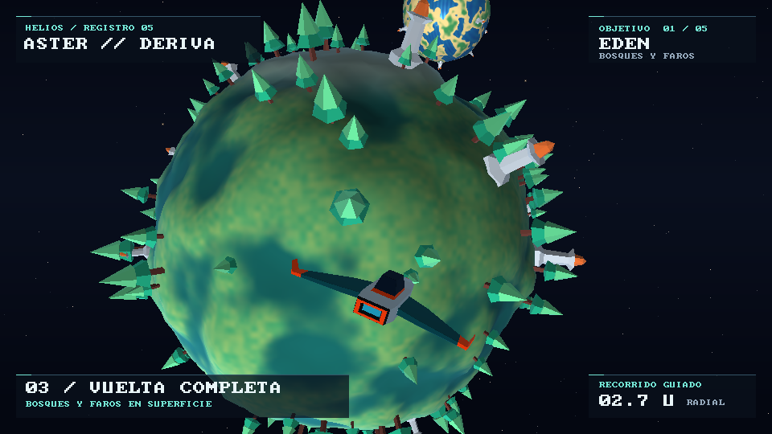

# Aster // Deriva

Explora **Helios**, un sistema solar en miniatura, desde la nave Aster. Puedes acercarte a cinco planetas, rodearlos en modo local y volver al espacio abierto. El escenario se dibuja en CPU con un renderizador por software escrito en Rust.



[Ver el video del recorrido (27 s)](demostracion.mp4) · [Guía de demostración y criterios](DEMOSTRACION.md)

## Ejecutar en Windows

Instala Rust estable con el toolchain MSVC, Visual Studio Build Tools con **Desarrollo para el escritorio con C++**, CMake y LLVM con `libclang`. Si Cargo no encuentra `libclang.dll`, configura `LIBCLANG_PATH` con la ruta a la carpeta que contiene esa DLL. La primera compilación descarga las dependencias.

Abre PowerShell en la carpeta del proyecto y ejecuta este comando.

```powershell
cargo run --locked --release
```

Usa `--release` para jugar. El proyecto incluye los modelos y materiales. Blender solo se necesita para editar la nave original.

## Controles

| Tecla | Acción |
| --- | --- |
| W / S | Avanzar y retroceder. En modo local, acercarse y alejarse radialmente |
| A / D | Desplazarse a los lados. En modo local, rodear el planeta |
| Q / E | Bajar y subir |
| Flechas | Orientar la nave y la cámara |
| Tab / T | Seleccionar el siguiente planeta / apuntar al seleccionado |
| F | Alternar vuelo libre y control local cuando hay un planeta a 18 unidades radiales o menos |
| Shift / Espacio | Impulso en vuelo libre / freno progresivo |
| P | Reproducir o salir del recorrido guiado |
| F1 | Mostrar datos del renderizador |
| C / L / G | Alternar descarte de objetos / detalle automático / gravedad |
| F12 / R / Esc | Guardar captura / reiniciar el vuelo / salir |

Para el primer vuelo, apunta a Edén con **T**, acércate con **W** y pulsa **F** cuando la distancia radial baje de 18. Pulsa **T** para centrar el planeta y mantén **A** o **D** para rodearlo. Usa las flechas si quieres mirar en otra dirección. Mantén **S** para alejarte. El modo libre vuelve automáticamente al superar 24 unidades radiales.

La distancia del tablero se mide desde el radio base del objetivo. El relieve y la distancia de seguridad de la nave hacen que la colisión se produzca antes de que el indicador marque cero.

## Planetas

| Planeta | Identidad | Detalles de cerca |
| --- | --- | --- |
| Edén | Praderas y bosques de coníferas | Árboles facetados y faros con remates naranjas |
| Vesper | Gigante de bandas y tormentas | Anillos concéntricos con huecos y nubes en movimiento |
| Nival | Glaciares con reflejos | Cristales y normal map procedural |
| Ferrum | Mundo rocoso de basalto y óxido | Cráter deformado en la malla, vetas y rocas |
| Lumen | Océanos y archipiélagos | Costas de arena, ondulación del agua y faros en tierra |

## Cómo funciona

1. `obj.rs` carga los vértices y triángulos de Aster y los colores de su MTL. `mesh.rs` subdivide un icosaedro para generar las esferas de 320, 1,280 o 5,120 triángulos. `world.rs` calcula el relieve después de subdividir y coloca los objetos con ruido de valor fractal y semilla reproducible.
2. `world.rs` calcula cada centro orbital y el giro propio a partir del tiempo de simulación. Las instancias de superficie guardan su posición y orientación en el espacio local del planeta. Se aplica a ambas la misma base de rotación que al suelo.
3. `render.rs` transforma vértices de modelo a mundo y a cámara, recorta contra el plano cercano y proyecta en perspectiva. El rasterizador recorre triángulos con baricéntricas. Usa la inversa de la profundidad para comprobar visibilidad y corregir la interpolación de atributos en perspectiva.
4. `shading.rs` calcula el color de cada fragmento visible. En Nival se muestrea un mapa de normales periódico de 64 × 64 y se transforma de espacio tangente a mundo antes de iluminar. Raylib crea la ventana, lee el teclado y presenta el framebuffer final como una textura 2D.
5. `flight.rs` integra la nave en pasos de 1/120 s. El control local incorpora la velocidad orbital del planeta de referencia. La gravedad modifica la velocidad y la colisión corrige la posición y elimina la componente entrante de la velocidad relativa.

## Reproducir y verificar

```powershell
cargo test --locked --release
cargo run --locked --release -- --smoke-test
cargo run --locked --release -- --seed 241274
cargo run --locked --release -- --inspect 3 nival.png
cargo run --locked --release -- --shot 12 capturas/eden.png
```

Puedes regenerar el MP4 con este comando si FFmpeg está disponible en `PATH`.

```powershell
cargo run --locked --release -- --video demostracion.mp4
```

La aplicación envía a FFmpeg los fotogramas generados por el mismo renderizador que usa el modo interactivo.

## Créditos y contribuciones

- **Miguel Rosas (241274)** · Modelado de la nave Aster en el Laboratorio 3. Se incluyen su archivo editable de Blender y la exportación OBJ/MTL. El lector OBJ/MTL y las operaciones vectoriales proceden del Laboratorio 4.
- **Asistencia de IA (OpenAI Codex)** · Implementación y verificación de la ampliación a perspectiva, escena solar, superficies procedurales, shaders, navegación, telemetría y recorrido guiado. También se usó para preparar la documentación y exportar el video.
- **Dependencias** · Raylib para ventana y presentación, `font8x8` para los glifos del tablero y `png` para guardar capturas. FFmpeg codifica el video de entrega.
